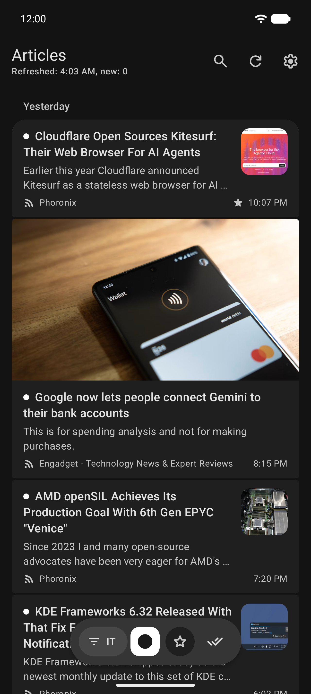
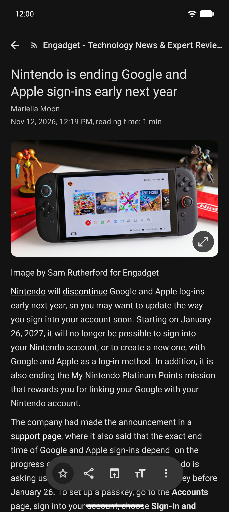
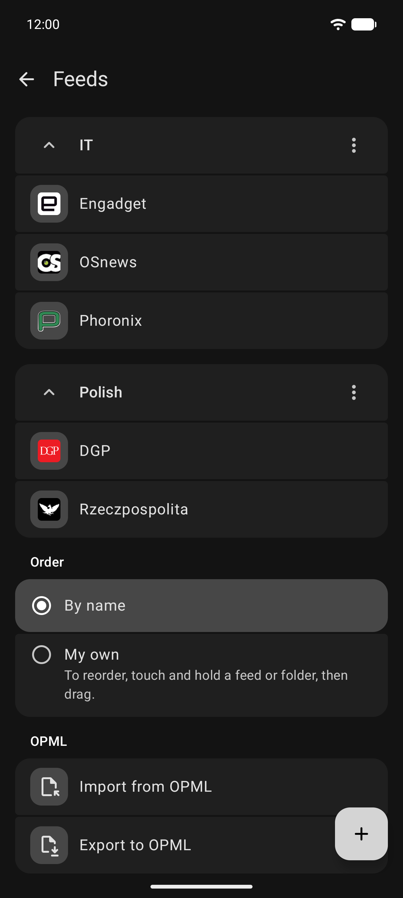
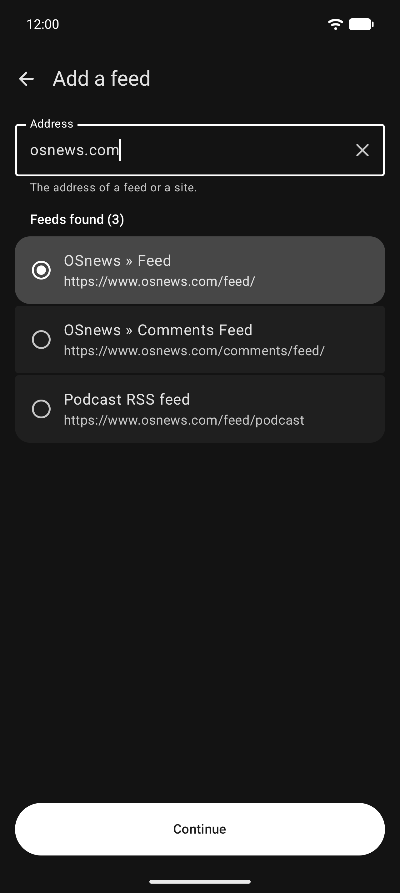
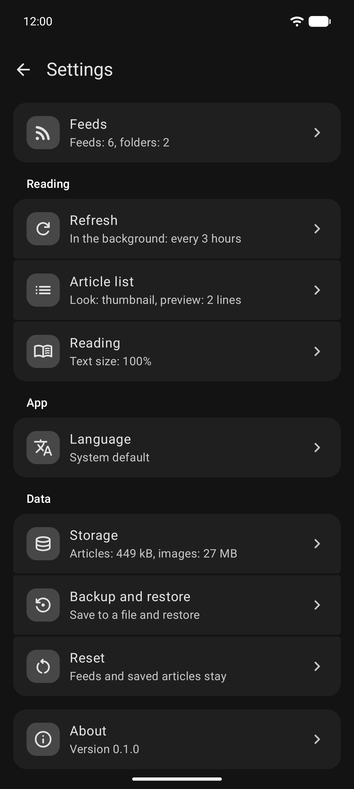

#  News

A private, full-text feed reader for Android (RSS and Atom) that keeps articles on the phone for reading offline.

**Current version**: v0.2.0

Source code and releases: [git.hnet.sh/hkr/news](https://git.hnet.sh/hkr/news)

Bug reports and feature requests: [github.com/legal-hkr/news](https://github.com/legal-hkr/news/issues)

## Overview

News is a reader for RSS and Atom feeds that fetches each article’s full text and images when it refreshes, so everything can be read without a network. It uses the Internet only to reach the sites of the feeds you subscribe to: no account, no server in between, no analytics. It doesn’t ask for your location, storage or media, asks for notifications only if you turn on the badge on its icon, and what you read stays on the device.

## Screenshots

     

## Features

### Feeds

- **RSS and Atom**: RSS 0.9x and 2.0, RDF and Atom; a site’s address is enough to find its feed
- **Folders**: In your own order or by name
- **OPML**: Import and export; an import never removes a feed
- **Share to News**: Sharing a page from the browser opens Add a feed and looks up the feed at that address
- **Per feed**: The full article page or the feed’s own content, with or without images, and its own look on the list

### Articles

- **One list**: Everything in one place, narrowed by source, unread only and saved only
- **Search**: In titles and full text, without a network and ignoring diacritics
- **Looks**: Text, thumbnail or large image, with up to three lines of preview
- **Swipe**: Mark as read or unread, or save; saved articles are never removed

### Reading

- **Native reader**: Headings, quotes, lists, code and tables, drawn by the app
- **Text**: Size and typeface, and the place where you stopped reading
- **Images**: Full screen with zoom, saving to Pictures and sharing
- **Feed content or full page**: For a single article, fetched on demand

### Refresh and storage

- **Background refresh**: At the interval you choose, without sound or interruptions
- **Badge on the icon**: Optional; shows that new articles have arrived, using one silent notification
- **Metered networks**: Only on unmetered networks if you wish, with a question before a manual refresh on a metered one
- **Failures**: Incomplete articles are marked and completed later; a feed that keeps failing is quietly marked
- **Storage**: Articles kept for as long as you set, for the whole app or for a single feed

### Widgets

- **Count**: The number of unread articles in a small pill
- **Newest article**: The newest unread article with its image
- **Headlines**: The newest unread articles, as many as fit in the widget
- **Source**: Each widget can show all feeds, one folder or a single feed; a tap opens the article or the list

### Settings

- **Backup and restore** of feeds, settings and saved articles with their text to a file you choose, also offered on the first start
- **Language**: English or Polish, independent of the system language

## Requirements

- Android 14 (API level 34) or higher

## Building

```bash
git clone https://git.hnet.sh/hkr/news.git
cd news
./gradlew assembleDebug
```

Set the Android SDK path in `local.properties` (`sdk.dir=…`) first. Unit tests run with `./gradlew test`.

## Contributing

Development happens on [git.hnet.sh](https://git.hnet.sh/hkr/news), where the releases are published too. The [GitHub repository](https://github.com/legal-hkr/news) is a read-only mirror, updated on every push, and the place to report problems:

- **Issues**: Open them on [GitHub](https://github.com/legal-hkr/news/issues), with the app version and your Android version
- **Pull requests**: Welcome on GitHub as well, but they can’t be merged there – accepted changes are applied on git.hnet.sh and reach the mirror from there, so the pull request itself ends up closed rather than merged

## Tech stack

- **Language**: Kotlin
- **Min SDK**: Android 14 (API 34), **target SDK**: API 37
- **UI**: Jetpack Compose with Material 3 Expressive
- **Network**: The system’s HTTP stack (HttpEngine), no cookies
- **Data**: Room, DataStore; images as files
- **Parsing**: jsoup, with the app’s own feed parser and article extractor

## License

[GPL-3.0](https://www.gnu.org/licenses/gpl-3.0.en.html)

## Acknowledgments

- [Claude](https://claude.ai) by Anthropic – AI assistant that provided valuable support during the development process, helping with code implementation, architecture decisions, and documentation
